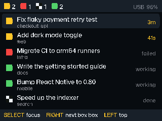

# pitwall 🏁

[](https://pypi.org/project/pitwall-agents/) [](LICENSE) [](https://github.com/siddhant573/pitwall)

**A pit wall for your coding agents.** See every agent session's state on a device on your desk, and jump to the right terminal tab with one button.

If you run 15–20 Claude Code sessions in iTerm tabs, you know the loop: cycle through tabs, find the one waiting on a permission prompt, approve it, repeat. pitwall shows you which session needs you, so you can stop hunting for it.

The first device is the **GitHub Universe 2026 badge** (Pimoroni Badger 2350). The protocol is open, so a Stream Deck, a macro keypad or anything else can join (see [Write your own device](#write-your-own-device)).

<p align="center"></p>

## The flags

| | State | Means |
|---|---|---|
| 🟢 | **Green flag** | the agent is working |
| 🟡 | **Box box** | the agent needs you: a permission prompt or a question |
| 🏁 | **Chequered flag** | the agent finished its turn |
| 🔴 | **Red flag** | the agent's turn failed |

The sessions waiting longest for you are always at the top.

## Requirements

- **macOS** with **iTerm2** (in `/Applications` or `~/Applications`). Other terminals, and sessions inside tmux, aren't supported yet.
- **Python 3.10+** and [pipx](https://pipx.pypa.io/)
- **Claude Code**
- The **GitHub Universe 2026 badge** on its stock firmware (MonaOS, MicroPython 1.29), plus a USB-C **data** cable. No badge? See `pitwall sim` below.

## Install

```bash
pipx install pitwall-agents
pitwall setup
```

(If `pitwall` isn't found afterwards, run `pipx ensurepath` and open a new terminal.)

`pitwall setup` finds your badge, your agents and your terminal, shows what it will do, and after one "yes":

1. writes `~/.pitwall/config.toml`
2. adds pitwall's hooks to Claude Code (`~/.claude/settings.json`, with a backup)
3. installs the Pitwall app on the badge (plug it in over USB first)
4. keeps the helper running in the background with a LaunchAgent (starts at login)

Then open **Pitwall** from the badge's home menu and **keep it plugged in until the header shows `USB`**: that's when the badge gets its Bluetooth key over the cable. New Claude Code sessions show up right away; sessions that were already open show up on their next prompt (or after a restart).

**Bluetooth is automatic** after that: unplug the badge and it switches to Bluetooth within a few seconds; plug it back in and it switches to USB.

**macOS asks once** to let pitwall control iTerm2 (to switch tabs) and use Bluetooth. Allow both. The prompt may name Python rather than pitwall, because the helper is a Python program.

No badge? `pitwall sim` shows the same board in a terminal tab, and `pitwall status` prints it once.

## Configure

`~/.pitwall/config.toml`:

```toml
terminal = "iterm2"
agents = ["claude-code"]

[devices.badger2350]          # GitHub Universe 2026 badge (Pimoroni Badger 2350)
transports = ["usb", "ble"]
```

For one run, `pitwall serve --device badger2350:usb` overrides the devices (repeat `--device` for several).

| Command | Does |
|---|---|
| `pitwall setup` | detect and install everything |
| `pitwall service install \| uninstall \| status \| restart` | the background LaunchAgent |
| `pitwall status` | print the board |
| `pitwall install claude-code` / `pitwall uninstall claude-code` | add or remove the hooks |
| `pitwall install badge` / `pitwall uninstall badge` | install or remove the badge app |
| `pitwall uninstall all` | remove everything (service, hooks, badge app, `~/.pitwall`) |
| `pitwall serve [-v] [--device …] [--config FILE] [--log-file FILE]` | run the helper in the foreground |
| `pitwall sim` | a simulated device in the terminal |

The background helper logs to `~/.pitwall/serve.log` (rotated at 1 MB).

## Badge buttons

| Button | Does |
|---|---|
| UP / DOWN | move the cursor |
| SELECT | jump to the selected session's tab |
| RIGHT | jump to the session that's waited longest for you (🟡) |
| LEFT | back to the top |

The badge's lights pulse when a session goes 🟡. If it loses the helper, it says **No connection**, dims the last board, and **SELECT restarts its Bluetooth**.

## What pitwall does and doesn't touch

- **It never acts on your agents.** Devices only show status and switch tabs. There's no approving or prompting from a button.
- **What it reads:** the hook sends the session id, its folder and the iTerm2 tab id, never your prompts, code or tool input. To label rows, the helper also reads your iTerm2 **tab titles**, where Claude Code puts a short topic for the session.
- **Where it goes:** only to the badge on your desk, over USB or over Bluetooth that's encrypted after pairing. No cloud, no accounts, no network calls.
- **Claude stays fast:** each hook call adds well under 0.1 s and never blocks or fails Claude, even when the helper isn't running.

## Troubleshooting

| Problem | Try |
|---|---|
| Badge says **No connection** | Press **SELECT** to restart its Bluetooth. Then check `pitwall service status`; `pitwall service restart` if it isn't running. |
| Bluetooth never connects | Plug the badge in with Pitwall open until it shows `USB` (that pairs it). Allow Bluetooth for the helper in System Settings → Privacy & Security → Bluetooth. |
| SELECT doesn't switch tabs | Allow controlling iTerm2 in System Settings → Privacy & Security → Automation. If you clicked "Don't allow", run `tccutil reset AppleEvents` and try again. |
| A session is missing | It appears on its next prompt. Check `pitwall-hook` is in `~/.claude/settings.json`, or run `pitwall install claude-code`. |
| `pitwall install badge` can't find the drive | Double-tap the badge's reset button to enter disk mode, then run it again. |
| Anything else | `tail -50 ~/.pitwall/serve.log`, or stop the service and run `pitwall serve -v` to watch. |

## Write your own device

Devices speak a tiny JSON-lines protocol. Connect to `~/.pitwall/devices.sock`, say `hello`, and you'll get a `board` every time something changes. Send `focus` to switch tabs. Everything is in **[docs/protocol.md](docs/protocol.md)**, and no pitwall code needs reading. Other agents can report sessions the same way, through `~/.pitwall/pitwall.sock`.

## Skills for your agent

The repo ships two [Claude Code skills](skills/): `pitwall` (set up, check, troubleshoot) and `pitwall-device` (build a new device on the protocol):

```bash
git clone https://github.com/siddhant573/pitwall
mkdir -p ~/.claude/skills && cp -r pitwall/skills/* ~/.claude/skills/
```

## Roadmap

- More devices: Stream Deck (one key per session), Logitech MX Creative Keypad
- More agents: Codex, Copilot CLI, Gemini CLI
- More terminals: Ghostty, WezTerm, tmux

## Uninstall

```bash
pitwall uninstall all          # service, hooks, the badge app + keys (if plugged in), ~/.pitwall
pipx uninstall pitwall-agents
```

`pitwall uninstall badge` removes just the badge app and its Bluetooth keys; the badge's own apps and menu are never touched.

## Contributing

Issues, ideas and device plug-ins are welcome; see [CONTRIBUTING.md](CONTRIBUTING.md).

## Like it?

⭐ **Star the repo** if pitwall saves you a few tab hunts. It helps other badge owners find it.

## License

MIT © Siddhant Sinha
